


 

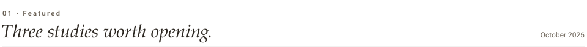

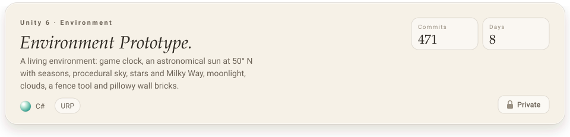
<a href="https://github.com/vuthelong/harbor-jelly">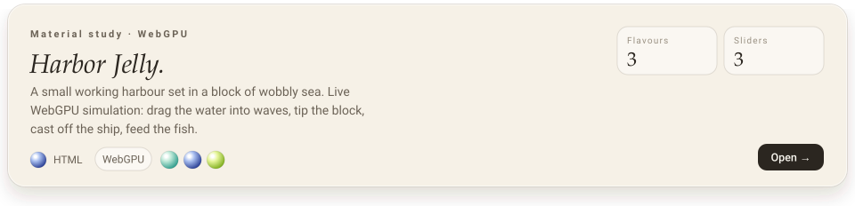</a>
<a href="https://github.com/vuthelong/unity-csharp-skills">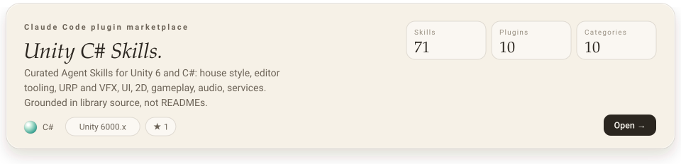</a>

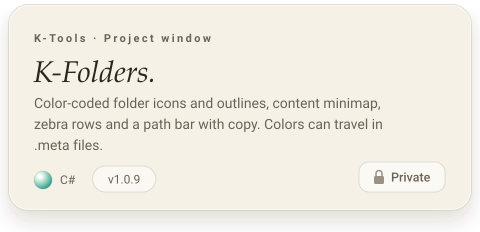
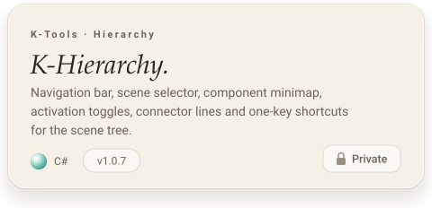
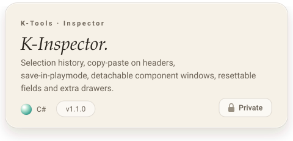
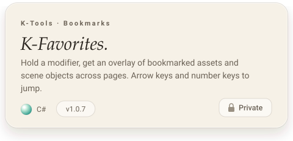
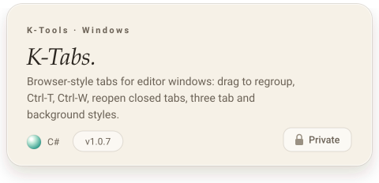
<a href="https://github.com/vuthelong/KEmoji">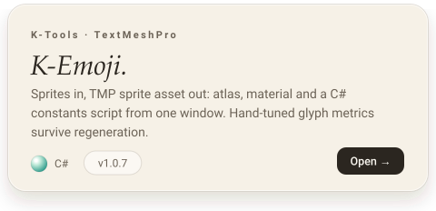</a>
<a href="https://github.com/vuthelong/KClipboard">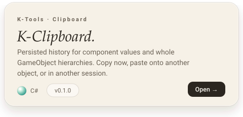</a>
<a href="https://github.com/vuthelong/KScene">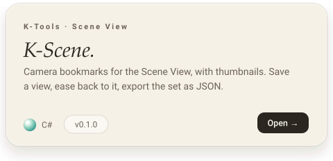</a>
<a href="https://github.com/vuthelong/KSetting">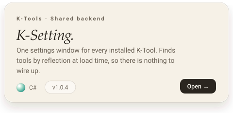</a>
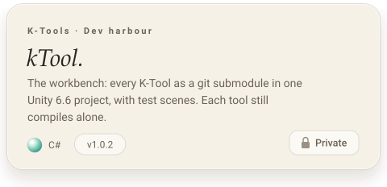

<a href="https://github.com/vuthelong/MacClipboard">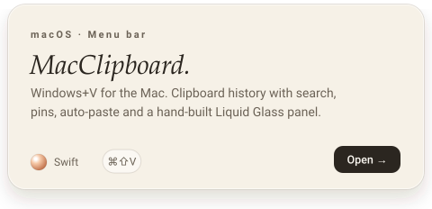</a>
<a href="https://github.com/vuthelong/loldle-discord-bot">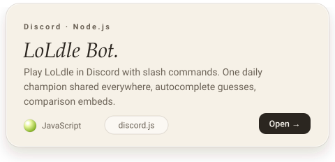</a>

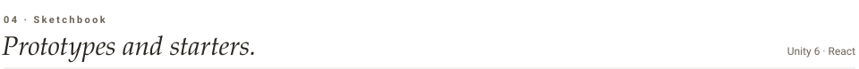

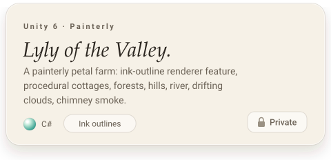
<a href="https://github.com/vuthelong/lily-of-valley">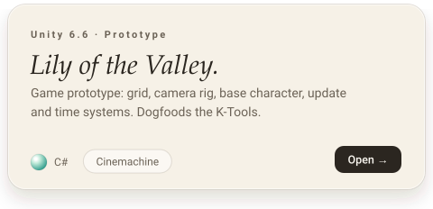</a>
<a href="https://github.com/vuthelong/Project14">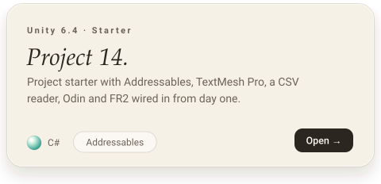</a>
<a href="https://github.com/vuthelong/cube">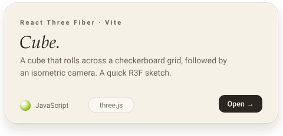</a>

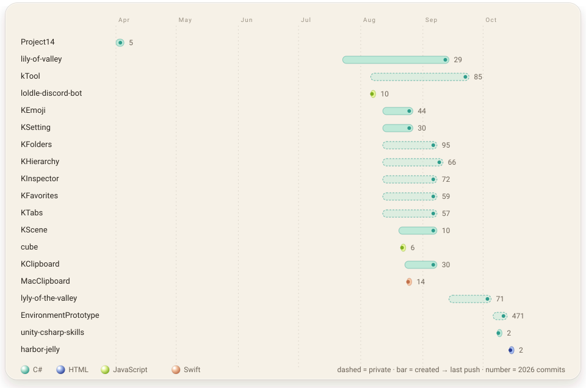

